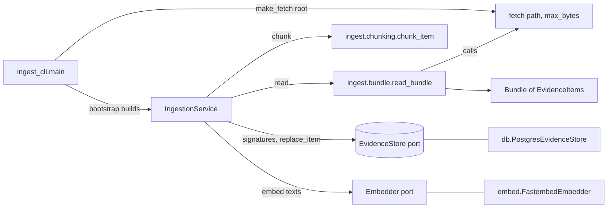

# Design Document: Evidence Ingestion

## BLOCKING FINDING (V0): fastembed does not run in the current venv

`import onnxruntime` and `import fastembed` crash the interpreter in the project `.venv` with an
access violation. The venv's base interpreter is miniconda Python 3.11.4 (`sys.base_prefix` is
`C:\Users\Abhishek Iyer\miniconda3`), which ships `msvcp140.dll 14.29.30153.0` next to `python.exe`.
Windows loads that old copy first, and onnxruntime 1.32.0 (pulled in by fastembed 0.9.1) needs the
newer C++ runtime. Details and the measured output are under Verification findings, V0.

Decision (question 1, resolved): the user rebuilds `.venv` themselves from a python.org CPython 3.11
(CI parity) instead of miniconda. No code change, keeps fastembed. The rebuild is a prerequisite of
the real-model work (walking skeleton step 6), verified by `python -c "import onnxruntime"` exiting 0
from `backend/` with the venv active. This blocks only the embed tasks (walking skeleton step 6). Chunking, the bundle reader,
the Fake_Embedder, the in-memory store, the Postgres store and the CLI with fakes do not need
onnxruntime. Because an import crash cannot be caught, no module imports `fastembed` at module
level (see Embed adapter).

## Overview

Evidence Ingestion loads a departed engineer's recorded work into Postgres as searchable chunks. An
operator points `python -m recromancer.ingest_cli <bundle-dir>` at an Evidence_Bundle. The pure
Bundle_Reader validates it, the pure Chunker splits each item, the `Embedder` port turns chunks into
384-dimension vectors (local `fastembed` adapter), and the `EvidenceStore` port writes items and
chunks idempotently (Postgres with an HNSW cosine index). A checked-in synthetic bundle (Ledgerline,
fictional engineer Priya Raman) makes demo mode "seeded data on the real code path".

Design principles for this spec:

1. **Small.** The only new ports are `Embedder` and `EvidenceStore` (plus the existing `Clock`). No
   registries, plugin systems or generic pipeline framework. The service is one class with one loop.
2. **Pure logic first.** Reading, hashing, chunking and signature computation are plain functions over
   dataclasses, so Hypothesis drives them directly.
3. **Fail closed, leak nothing.** Unknown fields, bad paths, wrong dimensions and offline-without-cache
   all stop the run before any write. No title, body or chunk text reaches a log line, an error
   message or stderr.
4. **Reuse the foundation.** Migration runner, `Settings.from_env`, `redact_text`, the CLI shape of
   `db/migrate.py` and the sync-pool-through-`anyio.to_thread` pattern of `db/postgres.py` are reused
   unchanged except where listed under Decisions.

### Requirement coverage map

| Requirement | Covered in |
|---|---|
| R1 Bundle format | Bundle_Reader; Data Models; Algorithms A1, A2; P3, EX-VIOLATIONS |
| R2 Ledgerline bundle | Ledgerline fixture; Testing Strategy |
| R3 Chunking | Chunker; Algorithm A3; P1, P2, EX-PARAMS |
| R4 Embedder | Embed adapter; Fake_Embedder; Verification findings V1 |
| R5 Storage | Migration 0002; Postgres store; Evidence_Store contract suite |
| R6 Ingestion service | IngestionService; Algorithm A4; P4, EX-REINGEST |
| R7 CLI | Ingest_CLI; Error Handling |
| R8 Verification | Correctness Properties; Testing Strategy |

## Verification findings

Measured on this machine on 2026-11-24 (Windows, project `.venv`, Docker Desktop with the compose
`db` service). Anything not listed here is a risk (see Risks) and is verified by the first task that
uses it.

### V0. onnxruntime access violation (blocking for embed tasks only)

```text
python -X faulthandler -c "import onnxruntime"
Windows fatal exception: access violation
exit(onnxruntime)=-1073741819          (0xC0000005)
import fastembed                        -> same failure
numpy 2.4.6, tokenizers 0.23.3         -> import fine
System32:     msvcp140.dll 14.51.36247.0   vcruntime140.dll 14.51.36247.0
Miniconda:    msvcp140.dll 14.29.30153.0   vcruntime140.dll 14.29.30153.0
```

Diagnosis confirmed: preloading the system copy first
(`ctypes.WinDLL(r'C:\Windows\System32\msvcp140.dll'); import onnxruntime`) printed
`onnxruntime ok 1.32.0`, exit 0. Second confirmation, evidence only (the chosen fix is a 3.11 venv): a throwaway venv from python.org
`C:\Python314\python.exe` (the only non-conda Python; `py -0p` lists only
`-V:3.14 * C:\Python314\python.exe`) printed `python 3.14.7 onnxruntime ok 1.32.0`, exit 0. The
throwaway venv was deleted.

| Option | Verdict |
|---|---|
| Recreate `.venv` from python.org CPython 3.11 (chosen, done by the user) | Zero code change, keeps fastembed, matches CI |
| Pin an older onnxruntime | Rejected: unverified which release works with MSVC 14.29; fragile |
| Switch to sentence-transformers and torch | Rejected: far larger dependency |

The Linux CI runner (setup-python, python.org builds) is unaffected. The first task adds a check to
`docs/DEV_SETUP.md` that `python -c "import onnxruntime"` succeeds (a later doctor check is open
question 24).

### V1. fastembed facts (gathered with the preload workaround, diagnostic only)

```text
pip index versions fastembed  ->  fastembed (0.9.1)
                                  Available versions: 0.9.1, 0.9.0, 0.8.1, ...
installed transitively: onnxruntime-1.32.0 numpy-2.4.6 tokenizers-0.23.3 huggingface-hub-1.33.0
  (plus loguru, requests, tqdm, pyyaml, mmh3, pillow, protobuf, py-rust-stemmers,
   flatbuffers, hf-xet, fsspec, filelock)
fastembed constraints (py 3.11-3.12): onnxruntime>=1.17.0,!=1.20.0,!=1.24.0,!=1.24.1
                                      huggingface-hub>=0.20,<2.0
py.typed shipped: True
TextEmbedding.__init__(self, model_name='BAAI/bge-small-en-v1.5', cache_dir: str | None = None,
    threads=None, providers=..., cuda=..., device_ids=None, lazy_load: bool = False, **kwargs)
embed(self, documents: Union[str, Iterable[str]], batch_size: int = 256,
    parallel: int | None = None, **kwargs) -> Iterable[numpy.ndarray]     (a generator)
offline: local_files_only=True via **kwargs; cached reload: offline_reload_ok 0.5 (seconds)
offline, empty cache: ValueError Could not load model BAAI/bge-small-en-v1.5 from any source.
list_supported_models(): dim 384, size_in_GB 0.067, sources.hf = 'Qdrant/bge-small-en-v1.5-onnx-Q',
    model_file 'model_optimized.onnx'
download: cache_bytes 67181330 (model_optimized.onnx 66465124, tokenizer.json 711396);
    first load including download: load_seconds 64.3
default cache: os.path.join(tempfile.gettempdir(), "fastembed_cache"), env override
    FASTEMBED_CACHE_PATH  ->  C:\Users\Abhishek Iyer\AppData\Local\Temp\fastembed_cache
vectors: type ndarray dtype float32 len 384 norm 1.0 (both samples)  -> already L2-normalised
token fit: tokens_for_1000_chars 202 for "word " * 200 (limit 512)
```

Consequences the design takes from V1:

- **Dependency.** `fastembed>=0.9.1` in `[project].dependencies` of `backend/pyproject.toml`. The lower
  bound comes from the `pip index versions fastembed` output above (R4.10). No new dev dependency.
  `onnxruntime` and `numpy` are not added as direct dependencies (open question 2).
- **Parameter names.** Cache directory is `cache_dir`; offline is `local_files_only=True` in `kwargs`;
  `embed` is a generator, so the adapter passes `batch_size=64` and converts each ndarray with
  `.tolist()` (no numpy import in product code).
- **Download source.** The model is the quantized ONNX export `Qdrant/bge-small-en-v1.5-onnx-Q` on
  Hugging Face, not the `BAAI` repo. Vectors therefore come from a quantized model. Recorded in
  `docs/DEV_SETUP.md` (R4.11, task).
- **Error mapping.** Offline with an empty cache raises `ValueError`; any exception while loading or
  embedding maps to a `RecromancerError` naming the model id (R4.12).
- **First run exceeds 60 s** (64.3 s measured). DEV_SETUP documents it as a one-time command and the
  optional real-model test runs only when the cache already exists.
- **Cache location risk.** `%TEMP%` can be cleaned by Windows. DEV_SETUP recommends a stable
  `RECROMANCER_EMBEDDING_CACHE_DIR`, example `C:\Users\<you>\.cache\recromancer` (decision 3).
- **Normalisation.** The library already returns unit vectors. The adapter still checks the norm and
  re-normalises when it is off by more than 1e-4, so a library change cannot break R4.13.
- **Noise on Windows.** huggingface_hub warns about unsupported symlinks (Developer Mode off) and about
  unauthenticated requests. Both go to stderr. Default: accept the noise; the design writes no
  environment variable (R7.7) (open question 4).
- **Token fit.** 1000 characters of English prose is about 202 tokens, far under 512. Code-heavy text
  tokenizes denser and fastembed truncates beyond 512 tokens silently; this is a recorded risk, not a
  blocker (requirements question 6 is answered for prose only).
- A probe cache of 67 MB remains at `%TEMP%\fastembed_probe_cache`. `pyproject.toml` is not yet changed
  and `fastembed==0.9.1` was installed into `.venv` by hand.

### V2. pgvector and HNSW (R5.5)

```text
docker exec recromancer-db-1 psql -U recromancer -d recromancer -At -c
  "SELECT name, default_version, installed_version FROM pg_available_extensions WHERE name = 'vector';"
  ->  vector|0.8.7|            (installed_version empty on this volume)
SHOW server_version;  ->  16.16 (Debian 16.16-1.pgdg12+1)
image pgvector/pgvector:pg16, container recromancer-db-1
BEGIN; CREATE EXTENSION IF NOT EXISTS vector; CREATE TABLE hnsw_probe (e vector(384));
CREATE INDEX ON hnsw_probe USING hnsw (e vector_cosine_ops); ... ROLLBACK;
  ->  CREATE INDEX / 0.8.7 / CREATE INDEX hnsw_probe_e_idx ON public.hnsw_probe
      USING hnsw (e vector_cosine_ops) / ROLLBACK
```

Plain `CREATE INDEX ... USING hnsw` works inside a transaction (R5.4) and 0.8.7 is at least 0.5.0.
Version 0.8.x also supports iterative index scans (`hnsw.iterative_scan`), relevant to filtered search
in the next spec and not used here. The migration task re-runs the query and pastes the output into
the migration header comment and `docs/DEV_SETUP.md` (R5.5).

### V3. import-linter and `ingest_cli` (R7.1, requirements question 10)

With a throwaway `src/recromancer/ingest_cli.py` importing `recromancer.bootstrap`,
`recromancer.config`, `recromancer.observability` and `recromancer.db`, the current contracts reported
`Contracts: 8 kept, 0 broken.` The module is in no contract's `source_modules` and C8 does not list it,
so the contracts neither allow nor forbid it. With `"ingest_cli",` added as the first line of C8's
`layers`, lint-imports again reported `Contracts: 8 kept, 0 broken.` The throwaway module was deleted.

Chosen change: in `[[tool.importlinter.contracts]] name = "layer-order"`, insert `  "ingest_cli",` as
the first entry of `layers`, before `  "bootstrap",`. `"bootstrap | ingest_cli"` is wrong because `|`
siblings are independent and would forbid `ingest_cli` importing `bootstrap`. The same task updates
`tests/unit/test_import_contracts.py::test_c8_layers_match_documented_order` (it asserts the exact
list) and `.kiro/steering/structure.md` (add `ingest_cli.py` beside `bootstrap` at the top of the layer
order, and `ingest/fixtures/`).

### Existing code that the design builds on (read, not assumed)

`db/runner.py` (`discover`, `run`, `Migration`), `db/postgres.py` (sync `ConnectionPool` plus
`anyio.to_thread.run_sync`, `_safe_message`, `_DRIVER_ERRORS`, `build_pool`), `db/migrate.py` (CLI
seams), `config.py` (`Settings`, `load_dotenv`, blank-secret validator, `extra="forbid"`),
`observability.py` (`configure_logging(stream=...)`, `redact_text`), `bootstrap.py` (`SystemClock`),
`service/ports.py` (`Clock`), `domain/errors.py` (`ErrorCode`, `RecromancerError` with a 500 character
message cap that raises `ValueError` if exceeded), `tests/fakes.py` and `tests/fakes_api.py`
(`FakeClock`), `tests/pg_support.py` (`throwaway_schema`), `tests/conftest.py` (`postgres_url`,
`pg_schema`, `log_stream`, Hypothesis profiles with 100 and 1000 examples).

## Architecture

### Module layout

```text
backend/src/recromancer/
  domain/
    errors.py           + BundleError, ChunkingError (ErrorCode.VALIDATION_ERROR; no new ErrorCode)
    evidence.py         NEW  ItemKind, Subject, EvidenceItem, Bundle, SourceLocator, Chunk,
                             EmbeddedChunk, ItemWrite, StoredItem, StoredChunk, FetchBytes,
                             DEFAULT_WORKSPACE_ID
  ingest/
    bundle.py           NEW  read_bundle(fetch) -> Bundle, content_hash(item), limits, patterns
    chunking.py         NEW  source_text(item), chunk_item(item, size, overlap), defaults
    fixtures/ledgerline/     NEW  data only: manifest.json, README.md, items; no __init__.py
  service/
    ports.py            + Embedder, EvidenceStore Protocols
    ingestion.py        NEW  IngestionService, IngestReport, IngestError, ingest_signature
  embed/
    fastembed_embedder.py   NEW  FastembedEmbedder (lazy fastembed import)
  db/
    evidence_store.py   NEW  PostgresEvidenceStore, EMBEDDING_DIMENSIONS = 384
    migrations/0002_create_evidence_tables.sql   NEW
  bootstrap.py          + evidence_store(), build_embedder(), build_ingestion_service()
  ingest_cli.py         NEW  main(), bundle loader (make_fetch), ledgerline_dir()
  config.py             + embedding_model_id, embedding_cache_dir, embedding_offline,
                          redaction_values()
backend/tests/
  fakes.py              + FakeEmbedder, FakeEvidenceStore
  property/invariants.py, strategies.py   + chunk and bundle invariants and strategies
  unit/ property/ contract/ integration/  new files listed in Testing Strategy
```

### Data flow



`read` and `chunk` are plain functions injected into the service by `bootstrap`; the service never
imports `ingest` (contract C4).

### Layers and every allowed import edge

Layer order after this spec, top to bottom: `ingest_cli`; `bootstrap`; `api | mcp`; `service`;
`llm | embed | retrieval | db`; `grounding | ingest`; `domain`. `config` and `observability` sit
beside the stack as before.

| Module | May import (project) | May import (third party) | Contract that enforces it |
|---|---|---|---|
| `domain/evidence.py`, `domain/errors.py` | nothing | stdlib | C1 |
| `ingest/bundle.py`, `ingest/chunking.py` | `domain` | stdlib | C2 (also forbids pydantic, anyio, structlog, psycopg) |
| `service/ports.py` | `domain` | stdlib | C4 |
| `service/ingestion.py` | `domain`, `service.ports` | stdlib, `structlog` | C4 (`structlog` is not forbidden there) |
| `embed/fastembed_embedder.py` | `domain.errors` | stdlib, `anyio`, `fastembed` (inside functions only) | C6, C7; structural port match proved in `bootstrap` |
| `db/evidence_store.py` | `domain`, `db.postgres` (private helpers `_safe_message`, `_DRIVER_ERRORS`) | stdlib, `psycopg`, `psycopg_pool`, `anyio` | C4, C7 |
| `bootstrap.py` | `api`, `config`, `db`, `embed`, `ingest`, `observability`, `service`, `domain` | stdlib, `fastapi`, `structlog` | C8 |
| `ingest_cli.py` | `bootstrap`, `config`, `observability`, `service.ports`, `domain` | stdlib | C8 (new top layer); no direct adapter or `ingest` import |
| `config.py` | `domain` | stdlib, `pydantic`, `pydantic-settings` | C3 |

**Indirect chains checked.**

- C4 has `allow_indirect_imports` false. `service` reaches only `domain` and `service.ports`, so no
  chain reaches `ingest`, `embed` or `db`.
- C2: `ingest` reaches only `domain`.
- C6: only `bootstrap` imports `embed`, `db` and `ingest`. `ingest_cli` imports `bootstrap`, which
  imports adapters. C6's `source_modules` do not list `ingest_cli` or `bootstrap`, so this chain is
  legal. Nothing imports `ingest_cli` (it is the top of C8), so `bootstrap` cannot import it.
- C5 (`allow_indirect_imports` true) lists only `api` and `mcp`; neither imports `ingest_cli`.
- C7: `embed` and `db` do not import each other. `db/evidence_store.py` imports `db.postgres`, inside
  one package.
- Gap kept deliberately small: nothing stops `ingest_cli` importing an adapter directly (it is in no
  forbidden contract). Review and the CLI unit tests catch it (open question 5).

### Chosen locations (short reasons)

- **Bundle_Loader** is `make_fetch(root)` in `ingest_cli.py`. It does disk I/O so it cannot live in
  `ingest` (C2), and only the CLI uses it in this spec. It takes an `importlib.resources.abc.Traversable`
  so the same code reads a directory path and the installed package (R2.11). A later API caller can
  move it to a new module without changing the reader.
- **Ingest_Signature** is `ingest_signature(...)` in `service/ingestion.py`. It is pure, takes only
  strings and ints, and the service is its only caller, so `domain` does not need it.
- **Fake_Embedder and in-memory store** are in `tests/fakes.py` beside `FakeMigrationStore`. Demo mode
  uses the real fastembed adapter, never a fake.
- **Errors.** `BundleError` and `ChunkingError` live in `domain/errors.py` because `ingest` may import
  only `domain`. Both use `ErrorCode.VALIDATION_ERROR`; embedder and store failures use
  `DEPENDENCY_UNAVAILABLE`; the startup dimension check uses `CONFIG_INVALID`. No new `ErrorCode`, so
  `ERROR_HTTP_STATUS`, `test_errors.py` and `test_api_errors.py` stay unchanged.

## Components and Interfaces

### Domain types (`domain/evidence.py`, stdlib dataclasses, all `frozen=True`)

```python
ItemKind = Literal["commit", "pull_request", "review", "issue", "doc"]
DEFAULT_WORKSPACE_ID = "default"
FetchBytes = Callable[[str, int], bytes]   # (bundle-relative path, max_bytes) -> at most max_bytes+1 bytes

@dataclass(frozen=True)
class Subject:      handle: str; display_name: str

@dataclass(frozen=True)
class EvidenceItem:
    id: str; kind: ItemKind; author: str; timestamp: datetime  # aware, UTC, whole seconds
    title: str; body: str; url: str | None; path: str | None   # exactly one is not None
    references: tuple[str, ...]; content_hash: str             # set only by read_bundle

@dataclass(frozen=True)
class Bundle:       bundle_id: str; subject: Subject; fictional: bool; items: tuple[EvidenceItem, ...]

@dataclass(frozen=True)
class SourceLocator: item_id: str; start_offset: int; end_offset: int; url: str | None; path: str | None

@dataclass(frozen=True)
class Chunk:
    chunk_id: str; position: int; item_id: str; kind: ItemKind; author: str
    timestamp: datetime; text: str; locator: SourceLocator

@dataclass(frozen=True)
class EmbeddedChunk: chunk: Chunk; vector: tuple[float, ...]; model_id: str

@dataclass(frozen=True)
class ItemWrite:    # the whole input of the atomic replace
    bundle_id: str; subject_handle: str; item: EvidenceItem; signature: str
    ingested_at: datetime; chunks: tuple[EmbeddedChunk, ...]

@dataclass(frozen=True)
class StoredItem:   bundle_id: str; subject_handle: str; item: EvidenceItem; signature: str; ingested_at: datetime
@dataclass(frozen=True)
class StoredChunk:  bundle_id: str; chunk: Chunk; vector: tuple[float, ...]; embedding_model: str
```

`BundleError(RecromancerError)` and `ChunkingError(RecromancerError)` go in `domain/errors.py`. Their
constructors truncate the message to 500 characters (the base class raises `ValueError` beyond that).

### Bundle_Reader (`ingest/bundle.py`)

```python
def read_bundle(fetch: FetchBytes) -> Bundle: ...        # pure; I/O happens only inside `fetch`
def content_hash(item: EvidenceItem) -> str: ...         # canonical form of A2
MANIFEST_MAX_BYTES = 262_144; ITEM_MAX_BYTES = 1_048_576; MAX_FILES = 5000
TITLE_MAX = 300; BODY_MAX = 200_000; REFERENCES_MAX = 100
```

The reader calls `fetch("manifest.json", MANIFEST_MAX_BYTES)` first, validates the whole manifest
(including every `path`, R1.12) and only then calls `fetch` for item files in manifest order. It never
touches the file system, so `ingest` stays framework-free. Patterns are applied with `re.fullmatch`
(`$` would accept a trailing newline) and written with explicit ranges (`[0-9]`, not `\d`, which matches
other Unicode digits).

### Chunker (`ingest/chunking.py`)

```python
DEFAULT_CHUNK_SIZE = 1000; DEFAULT_CHUNK_OVERLAP = 150; MAX_CHUNKS_PER_ITEM = 10_000
def source_text(item: EvidenceItem) -> str: ...          # title, or title + "\n\n" + body
def chunk_item(item: EvidenceItem, size: int = ..., overlap: int = ...) -> tuple[Chunk, ...]: ...
```

### Ports (`service/ports.py`)

```python
class Embedder(Protocol):
    @property
    def model_id(self) -> str: ...
    @property
    def dimensions(self) -> int: ...
    async def embed(self, texts: Sequence[str]) -> list[list[float]]: ...   # [] for []; same order

class EvidenceStore(Protocol):
    async def signatures(self, bundle_id: str) -> dict[str, str]: ...       # item_id -> signature
    async def replace_item(self, write: ItemWrite) -> None: ...             # one transaction
    async def get_item(self, bundle_id: str, item_id: str) -> StoredItem | None: ...
    async def get_chunks(self, bundle_id: str, item_id: str) -> tuple[StoredChunk, ...]: ...
```

`signatures` doubles as "list item ids for a bundle" (the keys), which is all the service needs for
the absent count. `get_item` and `get_chunks` exist for the contract suite and for the next spec's
citation reads; nothing in the service calls them. `Clock` is the existing port. There is no
similarity-search method here (see Contracts for grounded-chat).

### IngestionService (`service/ingestion.py`)

```python
@dataclass(frozen=True)
class IngestReport: items: int; chunks: int; unchanged: int; absent: int

class IngestError(RecromancerError):          # ErrorCode.DEPENDENCY_UNAVAILABLE
    item_id: str; report: IngestReport

def ingest_signature(content_hash: str, chunk_size: int, chunk_overlap: int, model_id: str) -> str:
    return f"v1|{content_hash}|{chunk_size}|{chunk_overlap}|{model_id}"

class IngestionService:
    def __init__(self, *, read: Callable[[FetchBytes], Bundle],
                 chunk: Callable[[EvidenceItem], tuple[Chunk, ...]],
                 chunk_size: int, chunk_overlap: int,
                 embedder: Embedder, store: EvidenceStore, clock: Clock) -> None: ...
    async def ingest(self, fetch: FetchBytes) -> IngestReport: ...
```

`chunk_size` and `chunk_overlap` feed only the signature. `bootstrap` binds the same two constants into
`chunk` with `functools.partial`, so both come from one place (`DEFAULT_CHUNK_SIZE`,
`DEFAULT_CHUNK_OVERLAP`). Signature fields are separated by `|`, which cannot occur in a hex digest or
an integer, and the model id is last, so two different tuples never give the same string.

### Embed adapter (`embed/fastembed_embedder.py`)

```python
class FastembedEmbedder:
    def __init__(self, *, model_id: str, cache_dir: str | None, offline: bool,
                 model_factory: Callable[[str, str | None, bool], _TextModel] | None = None) -> None: ...
    @property
    def model_id(self) -> str: ...
    @property
    def dimensions(self) -> int: ...         # from list_supported_models() "dim"; unknown id -> error
    async def embed(self, texts: Sequence[str]) -> list[list[float]]: ...
```

- `fastembed` is imported **inside** `_default_model_factory` and `_lookup_dimensions`, never at module
  level. A module-level import would crash every process that imports `bootstrap` on the current venv
  (V0), because an access violation cannot be caught. `model_factory` is the test seam; unit tests pass
  a fake model and never import fastembed or onnxruntime.
- `embed([])` returns `[]` before touching the model or the factory (R4.1).
- `embed` runs `anyio.to_thread.run_sync(self._embed_sync, list(texts))` with the default
  `abandon_on_cancel=False`. `_embed_sync` builds the model on first use under a `threading.Lock`,
  slices the input into batches of at most 64, calls `model.embed(batch, batch_size=64)`, converts each
  ndarray with `.tolist()`, checks `len(vector) == self.dimensions`, and normalises (A5).
- Constructing the model passes `cache_dir=cache_dir` and, when `offline`, `local_files_only=True`.
  One attempt, no retry loop in our code (R4.12).
- Every exception from load or embed becomes
  `RecromancerError(DEPENDENCY_UNAVAILABLE, f"embedding model {model_id} could not be loaded")` or
  `... "failed to embed"`, raised `from None`, so no driver text, path or input text escapes.
  A dimension mismatch names both numbers (R4.5).

### Fake_Embedder and in-memory store (`tests/fakes.py`)

- `FakeEmbedder(dimensions=384, model_id="fake-embed-v1")`: vector from `hashlib.blake2b(text, digest_size=64,
  person=counter)` expanded to `dimensions` floats in [-1, 1], then L2-normalised (a zero vector falls
  back to the first basis vector). Records `calls` (invocations, including empty) and `texts_embedded`.
  Optional `fail_on_call: int | None`.
- `FakeEvidenceStore(dimensions=384, fail_on_item_ids=frozenset())`: dictionaries keyed like the
  Postgres primary key. `replace_item` builds the new state and swaps it in one assignment, so a
  rejected write (wrong dimension, injected failure by item id) leaves the old state. `snapshot()`
  returns a deterministic nested tuple (fake-only). Failure injection uses constructor arguments, never
  markers inside text, so generators cannot collide with it.

### Postgres store (`db/evidence_store.py`)

```python
EMBEDDING_DIMENSIONS = 384
class PostgresEvidenceStore:
    def __init__(self, pool: ConnectionPool, *, workspace_id: str = DEFAULT_WORKSPACE_ID) -> None: ...
```

Every method runs a sync function through `anyio.to_thread.run_sync` (same pattern as
`PostgresReadinessProbe`). `replace_item`:

1. Validate before connecting: every vector has length `EMBEDDING_DIMENSIONS` and only finite floats,
   else `RecromancerError(VALIDATION_ERROR, ...)` naming the chunk id and both lengths (R5.9).
2. `with pool.connection() as conn, conn.transaction():` upsert the item row
   (`INSERT ... ON CONFLICT (workspace_id, bundle_id, item_id) DO UPDATE`), `DELETE` its chunks, insert
   the new chunks with `executemany`. Vectors are written as the text literal `'[v1,v2,...]'` cast with
   `%s::vector`, built from `repr(float)`, so the `pgvector` Python package is not needed (Risks).
3. Driver errors map to `RecromancerError(DEPENDENCY_UNAVAILABLE, _safe_message(...))`, chained
   `from None` (the driver can quote the connection string).

READ COMMITTED isolation plus one transaction means a concurrent reader sees all old or all new rows
of the item (R5.8). Reads parse `embedding::text` back into floats.

### Composition root (`bootstrap.py` additions)

```python
@contextmanager
def evidence_store(settings: Settings) -> Iterator[EvidenceStore]:   # opens and closes the pool
def build_embedder(settings: Settings) -> Embedder:                   # FastembedEmbedder from Settings
def build_ingestion_service(settings, *, store, embedder, clock) -> IngestionService:
    # raises RecromancerError(CONFIG_INVALID, "embedder dimensions A != column dimensions 384")
    # BEFORE returning, so nothing is written (R5.12)
```

`evidence_store` calls `pool.open(wait=True, timeout=10)` and maps `PoolTimeout` to
`RecromancerError(DEPENDENCY_UNAVAILABLE, "database unavailable")`. Assignments such as
`embedder: Embedder = FastembedEmbedder(...)` let mypy prove the structural match, as for the existing
probe.

### Ingest_CLI (`ingest_cli.py`)

```python
def main(argv: Sequence[str] | None = None, *,
         environ: MutableMapping[str, str] | None = None,
         store_factory: Callable[[Settings], AbstractContextManager[EvidenceStore]] | None = None,
         embedder_factory: Callable[[Settings], Embedder] | None = None,
         stdout: TextIO | None = None, stderr: TextIO | None = None,
         clock: Clock | None = None, dotenv_start: Path | None = None) -> int: ...
def ledgerline_dir() -> Traversable: ...      # resources.files("recromancer.ingest") / "fixtures" / "ledgerline"
def make_fetch(root: Traversable) -> FetchBytes: ...
```

Order of work: (1) argument count, usage line on stderr, return 1 (no factory is called); (2)
`load_dotenv`, `Settings.from_env`, `configure_logging(stream=err, secret_values=settings.redaction_values())`;
(3) bundle directory check; (4) `with store_factory(settings) as store`; `embedder_factory(settings)`;
`build_ingestion_service(...)`; (5) `asyncio.run(service.ingest(make_fetch(root)))`
(`anyio.run` is equally fine; `asyncio.run` keeps the default event loop, and psycopg's sync pool is used
so the Windows Proactor limitation does not apply); (6) print one line. `make_fetch`:

- rejects `path` that is absolute, has a backslash, an empty or `..` segment (defence in depth next to the
  reader's own check; R1.12), joins segments with `Traversable.joinpath`, and for real `Path` roots also
  checks `resolve()` stays under `root.resolve()` (symlink escape);
- opens the file `"rb"` and reads at most `max_bytes + 1`;
- maps `FileNotFoundError`, `IsADirectoryError`, `PermissionError`, `OSError` to
  `BundleError(f"cannot read bundle file {path}")` (no OS error text).

### Settings additions (`config.py`) and `.env.example`

```python
embedding_model_id: str = "BAAI/bge-small-en-v1.5"   # 1..200 characters, no whitespace
embedding_cache_dir: Path | None = None              # must be absolute; blank value means None
embedding_offline: bool = False
def redaction_values(self) -> tuple[str, ...]        # secret_values() plus the database password
```

`.env.example` gains `RECROMANCER_EMBEDDING_MODEL_ID=BAAI/bge-small-en-v1.5`,
`RECROMANCER_EMBEDDING_CACHE_DIR=` (blank) and `RECROMANCER_EMBEDDING_OFFLINE=false`. The model id
default is configuration, not a hard-coded id in an adapter. `redaction_values` is the logic now private
in `db/migrate.py::_redaction_seed`; `migrate.py` calls it instead (open question 15).

### Ledgerline fixture (`ingest/fixtures/ledgerline/`)

Layout: `manifest.json`, `README.md` (states that everything is fictional), `commits/`, `pull_requests/`,
`reviews/`, `issues/`, `docs/` (one `.json` per item, `.md` per doc). Planned 31 items: 8 commits, 7 pull
requests, 8 reviews, 4 issues, 4 docs. Ids look like `pr-0142-remove-redis-cache`. Manifest order is by
timestamp. URLs are `https://example.invalid/ledgerline/...`. All files are LF, UTF-8, no BOM.

Planted facts (each resolvable by id in tests):

| Fact | Items |
|---|---|
| Why the Redis cache was removed | PR authored by `priya-raman`; two review items on it (one by another author, one reply by the subject) |
| Why idempotency keys were added | incident issue stating the reason; commit whose `references` include the issue |
| Design review objection | doc plus a subject-authored review referencing the doc, stating objection and reason |

Planted silences: no title or body matches `kubernetes|k8s|helm|hire|hiring|recruit|interview|candidate|headcount`
(case-insensitive). Files in the directory that the manifest does not list (for example `README.md`) are
ignored by the reader.

Packaging: no `__init__.py` is needed, `resources.files("recromancer.ingest")` joins a data path.
hatchling includes non-`.py` files under `packages = ["src/recromancer"]` unless `.gitignore` excludes
them; none of the repo's ignore patterns match these names. A test builds the wheel and checks the zip
listing (R2.11), see Testing Strategy. `.gitattributes` gains
`backend/src/recromancer/ingest/fixtures/** text eol=lf` (R2.10).

## Data Models

### Migration `db/migrations/0002_create_evidence_tables.sql`

```sql
-- Verified on <date>: SELECT name, default_version FROM pg_available_extensions WHERE name = 'vector';
--   -> vector|0.8.7   (paste the fresh output when the task runs; HNSW needs 0.5.0 or later)
-- No CREATE INDEX CONCURRENTLY: this file runs in the runner's single transaction.

CREATE TABLE evidence_items (
    workspace_id     text        NOT NULL DEFAULT 'default',
    bundle_id        text        NOT NULL,
    item_id          text        NOT NULL,
    kind             text        NOT NULL,
    author           text        NOT NULL,
    subject_handle   text        NOT NULL,
    occurred_at      timestamptz NOT NULL,
    title            text        NOT NULL,
    body             text        NOT NULL,
    url              text,
    path             text,
    references_ids   text[]      NOT NULL DEFAULT '{}',
    content_hash     text        NOT NULL,
    ingest_signature text        NOT NULL,
    ingested_at      timestamptz NOT NULL,
    PRIMARY KEY (workspace_id, bundle_id, item_id),
    CONSTRAINT evidence_items_kind_check
        CHECK (kind IN ('commit', 'pull_request', 'review', 'issue', 'doc')),
    CONSTRAINT evidence_items_locator_check
        CHECK ((url IS NULL) <> (path IS NULL))
);

CREATE TABLE evidence_chunks (
    workspace_id    text        NOT NULL DEFAULT 'default',
    bundle_id       text        NOT NULL,
    item_id         text        NOT NULL,
    chunk_id        text        NOT NULL,
    position        integer     NOT NULL,
    start_offset    integer     NOT NULL,
    end_offset      integer     NOT NULL,
    text            text        NOT NULL,
    embedding       vector(384) NOT NULL,
    embedding_model text        NOT NULL,
    PRIMARY KEY (workspace_id, bundle_id, chunk_id),
    FOREIGN KEY (workspace_id, bundle_id, item_id)
        REFERENCES evidence_items (workspace_id, bundle_id, item_id) ON DELETE CASCADE,
    CONSTRAINT evidence_chunks_span_check
        CHECK (position >= 0 AND start_offset >= 0 AND end_offset > start_offset)
);

CREATE INDEX evidence_chunks_item_idx ON evidence_chunks (workspace_id, bundle_id, item_id);
CREATE INDEX evidence_chunks_embedding_hnsw ON evidence_chunks USING hnsw (embedding vector_cosine_ops);
```

No full-text column (requirements question 12). `url` and `path` are exactly one non-null (the `<>` on
two null tests is an exclusive or). The file is UTF-8, LF, no BOM (R5.11); `discover` already rejects a
BOM, and a unit test checks for `\r`.

### Row mapping

| `evidence_items` column | Source |
|---|---|
| `workspace_id` | store constructor (`DEFAULT_WORKSPACE_ID`), default `'default'` |
| `bundle_id`, `subject_handle` | `ItemWrite` |
| `item_id`, `kind`, `author`, `title`, `body`, `url`, `path`, `content_hash` | `EvidenceItem` |
| `occurred_at` | `EvidenceItem.timestamp` |
| `references_ids` | `EvidenceItem.references` |
| `ingest_signature`, `ingested_at` | `ItemWrite` |

`evidence_chunks`: `chunk_id`, `position`, `item_id`, `text` from `Chunk`; `start_offset`, `end_offset`
from `Chunk.locator`; `embedding`, `embedding_model` from `EmbeddedChunk`.

## Algorithms

### A1. Bundle_Reader validation order (first violation wins, R1.13)

```text
read_bundle(fetch):
  raw  = fetch("manifest.json", MANIFEST_MAX_BYTES)
  text = decode(raw, "manifest.json")            # size, BOM, UTF-8, in that order
  doc  = parse_json(text, "manifest.json")       # rejects duplicate keys, NaN, Infinity, RecursionError
  manifest = check_manifest(doc)                 # per object: unknown field, missing field, then field
                                                 # checks in requirement order; every files[].path rule
  seen = {}
  for entry in manifest.files:                   # manifest order = result order (R1.11)
      raw  = fetch(entry.path, ITEM_MAX_BYTES)
      item = read_json_item(entry, raw)  if entry.kind != "doc"  else  read_doc(entry, raw)
      if item.id in seen: raise BundleError(duplicate id)
      seen[item.id] = item
  for item in items (manifest order):            # cross-item checks need every item
      each reference in `seen`, else BundleError
      if item.author != subject.handle: kind == "review" and references a subject-authored item
  return Bundle(...)
```

Details:

- `text` decoding: `len(raw) > max` first, then `raw.startswith(b"\xef\xbb\xbf")`, then
  `raw.decode("utf-8")` (strict).
- Type checks use `type(v) is int` for integers so JSON `true` is not accepted as `1`.
- Text fields (`title`, `body`, Markdown): normalise `\r\n` then `\r` to `\n`, then check length, then
  require that `s.encode("utf-8")` succeeds and `"\x00" not in s` (a lone surrogate cannot be hashed or
  stored and Postgres `text` cannot hold NUL; decision 11).
- `timestamp`: must `re.fullmatch(r"[0-9]{4}-[0-9]{2}-[0-9]{2}T[0-9]{2}:[0-9]{2}:[0-9]{2}Z")` and parse
  with `datetime.strptime(..., "%Y-%m-%dT%H:%M:%SZ")`; a parse failure is a field violation.
- `url`: `urlsplit` scheme is `https` and `hostname` is non-empty. `path`: non-empty, no leading `/`, no
  backslash, no empty or `..` segment.
- Doc entries: `read_doc` takes `id`, `author`, `timestamp`, `title` from the entry, the body from the
  Markdown file, `path = entry.path`, `url = None`, `references = ()`.
- Error text: `BundleError(f"{file}: field {field}: {reason}")` where `reason` is a fixed phrase. A field
  name that came from the file (unknown field) is shown through `ascii(name)[:40]`. Nothing from a
  value is ever included, so no body or title text can appear.
- Files in the bundle directory that the manifest does not list are never fetched.

### A2. Canonical form and Content_Hash

```text
payload = {"id", "kind", "author", "timestamp": "YYYY-MM-DDTHH:MM:SSZ", "title", "body",
           "url": str|None, "path": str|None, "references": list}      # after LF normalisation
content_hash = sha256(json.dumps(payload, sort_keys=True, separators=(",", ":"),
                                 ensure_ascii=False).encode("utf-8")).hexdigest()
```

The absent one of `url` and `path` is JSON `null`, so moving a value from `url` to `path` changes the
hash. `references` keep their order.

### A3. Chunk boundaries (R3.4, R3.5)

```text
chunk_item(item, size, overlap):
  validate: size >= 1, overlap >= 0, overlap < size, else ChunkingError
  text = source_text(item);  n = len(text);  if n == 0: return ()
  window = min(200, size - overlap - 1);  start = 0;  chunks = []
  loop:
    if n - start <= size:  end = n;  final = True
    else:
      lo, hi = start + size - window, start + size
      i = text.rfind("\n\n", lo, hi)           # paragraph break entirely inside [lo, hi)
      if i != -1:  end = i + 2
      else:
        j = text.rfind("\n", lo, hi)
        if j != -1:  end = j + 1
        else:
          end = first k from hi-1 down to lo with text[k].isspace(), then k + 1, else hi
    append Chunk(position=len(chunks), start, end, text[start:end]);  if len(chunks) > 10_000: ChunkingError
    if final: break
    start = end - overlap
```

Why `start` strictly increases: `end >= lo = start + size - window` and
`window <= size - overlap - 1`, so `end - overlap >= start + 1`. "Unicode whitespace" means
`str.isspace()`. Offsets count code points, so astral characters are one unit. The 10000 cap is checked
inside the loop, before a huge list is built. A position is at most 9999, so the 4-digit padding is
always enough and `item_id#position` is unambiguous because `#` is not in the Item_Id alphabet.

### A4. Ingestion loop (R6.3 to R6.7)

```text
ingest(fetch):
  bundle  = read(fetch)                                  # BundleError propagates; nothing written
  stored  = await store.signatures(bundle.bundle_id)
  absent  = len(stored.keys() - {i.id for i in bundle.items})   # known up front
  report  = IngestReport(0, 0, 0, absent)
  for item in bundle.items:
      sig = ingest_signature(item.content_hash, chunk_size, chunk_overlap, embedder.model_id)
      if stored.get(item.id) == sig:  report.unchanged += 1; report.items += 1; continue
      try:
          chunks  = chunk(item)
          vectors = await embedder.embed([c.text for c in chunks])      # one batch per item
          check len(vectors) == len(chunks) and each len == embedder.dimensions
          await store.replace_item(ItemWrite(..., ingested_at=clock.now(), chunks=...))
      except Exception:                                  # not BaseException: cancellation passes
          raise IngestError(item.id, report) from None   # earlier items stay committed
      report.items += 1; report.chunks += len(chunks)
  log one INFO summary (counts only)
  return report
```

`IngestError` message: `ingest failed at item <id>: items=<n> chunks=<n> unchanged=<n> absent=<n>`
(at most 64 + 80 characters). The failed item's stored state is untouched because `replace_item` is
atomic and embedding happens before any write. Per-item logs are DEBUG events with `item_id`, `chunks`
and `text_len` only.

### A5. Adapter normalisation and error mapping

```text
norm = sqrt(sum(x * x for x in v))
if not isfinite(norm) or norm == 0: raise RecromancerError(...)
if abs(norm - 1.0) > 1e-4: v = [x / norm for x in v]
```

## Correctness Properties

*A property is a characteristic or behavior that should hold true across all valid executions of a
system-essentially, a formal statement about what the system should do. Properties serve as the bridge
between human-readable specifications and machine-verifiable correctness guarantees.*

PBT applies to four pure behaviours: chunk coverage, chunk ids, the content hash and ingestion
idempotency over in-memory fakes. Invalid chunk parameters, edited-bundle re-ingest and the R1
violation rules are example tests (EX-PARAMS, EX-REINGEST, EX-VIOLATIONS, below).
It does not apply to the Postgres adapter, the fastembed adapter, the migration, the CLI wiring or the
fixture content; those use example, contract and integration tests. Each property is one Hypothesis
test with at least 100 examples (the repo's `default` profile; `ci` uses 1000) and a comment
`# Feature: evidence-ingestion, Property N: <title>`.

Shared generator rules (they cannot produce invalid states):

- Texts: `st.text(alphabet=st.characters(exclude_categories=("Cs",), exclude_characters="\x00"))`
  mixed with a `st.sampled_from(["\n", "\n\n", " ", "\t", "\u00e9", "\U0001F680"])` mixer so paragraph
  breaks, whitespace and multi-byte and astral characters are common. CR is excluded except in P3.
- Chunk parameters come from one composite that draws `size` first and then `overlap` in
  `[0, size - 1]`, so `overlap < size` always holds. Invalid parameters are never generated (EX-PARAMS covers them).
- Bundle models come from a composite that builds items constructively: Item_Ids from
  `[a-z0-9]` plus `[a-z0-9._-]{2,63}` with `unique=True`; subject-authored items of any kind first;
  non-subject items only as `review` with at least one reference drawn from the subject-authored ids;
  other references drawn from all ids; timestamps from `st.datetimes` rendered in the required form;
  exactly one of `url` (`https://example.invalid/...`) or `path`. A model is serialised to bytes with
  `json.dumps` and served through a fake `fetch`. Failure injection is by constructor argument, never by
  text, so no reserved marker can appear in generated text.
- The generator-validity test (R8.9) passes every generated bundle through `read_bundle`.

### Property 1: Chunking covers the text without loss and follows the boundary rule

*For any* text (including empty, whitespace-only, multi-byte and LF-only 5000 to 20000 characters),
valid `size` and valid `overlap`, the chunks of an item built from it satisfy: the first start is 0 and
the last end is the text length; each chunk's `text` equals the slice `source[start:end]`; starts
strictly increase; consecutive chunks overlap by exactly `overlap`; concatenating the first chunk and
`text[overlap:]` of each later chunk reproduces the source; a text of length at most `size` gives one
chunk; every non-final end lies in `[start + size - window, start + size]` and equals the position
chosen by an independent oracle of the paragraph, line, whitespace, hard-cut priority; each chunk
carries the item's id, kind, author, timestamp and a locator with the same offsets and the item's
`url` or `path`; the empty text gives no chunks.

**Oracle.** `assert_lossless_cover` and `assert_boundary_rule` in `invariants.py`. The boundary oracle
scans with explicit loops from `hi` downward over characters, so it does not share `str.rfind` with the
implementation.
**Boundary cases.** empty; length `size`; length `size + 1`; only `\n`; `\n\n` straddling `lo` and `hi`;
`overlap = 0`; `overlap = size - 1` (window 0); `size = 1`; `size = 2`.
**Mutation_Checks.** drop the final character of the last chunk; start the next chunk at `E + 1`
instead of `E - overlap`; use `rfind(..., lo, hi + 1)`. Each must fail this property.
**Validates: Requirements 3.2, 3.3, 3.4, 3.5, 3.7, 3.8, 3.10, 3.11, 8.2**

### Property 2: Chunk ids are deterministic, well formed and unique

*For any* bundle of items with distinct ids, every chunk id equals `<item_id>#<position:04d>`, the ids of
one item are pairwise distinct, the ids across all items are pairwise distinct, and chunking the same
bundle twice gives equal chunk tuples.

**Oracle.** string formatting in the test plus `len(set(ids)) == len(ids)`.
**Boundary cases.** items whose ids are prefixes of each other (`abc`, `abc.1`); single-chunk and
multi-chunk items.
**Mutation_Check.** build the id from the position alone: the uniqueness assertion fails.
**Validates: Requirements 3.6, 3.9, 8.2**

### Property 3: Content_Hash ignores line-ending style and reacts to every content field

*For any* valid item, serialising it with LF or with CRLF or lone CR in `title` and `body` (values
rewritten before `json.dumps`; Markdown bytes rewritten for docs) and reading it gives equal items and
equal Content_Hashes. *For any* valid item and any single change to `title`, `body`, `author`,
`timestamp` or `references` that produces a different normalised value, `content_hash` differs.

**Oracle.** equality of the two hashes, and inequality for the changed copy built with
`dataclasses.replace`. **Generator.** base texts contain no `\r`, so the CRLF rewrite is reversible by
the reader's normalisation; changed values are drawn with `.filter(lambda v: v != original)`.
**Boundary cases.** body empty; text ending in `\r`; `\r\r\n`.
**Mutation_Check.** skip normalisation before hashing: the CRLF half fails. Hash only `title` and `body`:
the sensitivity half fails for `author`.
**Validates: Requirements 1.10, 8.4**

### Property 4: Ingesting a bundle twice changes nothing

*For any* generated bundle and any chunk parameters, after the first ingest the store content equals the
content after a second ingest, the second report has `chunks == 0` and `unchanged == items`, and the
Fake_Embedder call counter does not change during the second run, even though the injected clock moved
between the runs.

**Oracle.** `FakeEvidenceStore.snapshot()` equality (it includes `ingested_at` and signatures) and the
embedder counters. **Boundary cases.** zero items; one item; items with one chunk and with many.
**Mutation_Check.** add `ingested_at` to the Ingest_Signature: the second run re-embeds and the property
fails.
**Validates: Requirements 6.3, 6.4, 6.8, 8.3**

### Example tests (not properties, no Hypothesis)

These three cover behaviour that a small set of concrete cases pins down fully. Each has a stable
name used in the traceability table.

**EX-PARAMS (`tests/unit/test_chunking.py`, parametrized).** Invalid parameters raise `ChunkingError`
and return nothing: `size = 0`, `size = -1`, `overlap = -1`, `overlap = size`, `overlap = size + 1`.
Valid boundary cases return chunks: `size = 1, overlap = 0` and `size = 5, overlap = 4`
(`overlap = size - 1`). A cap case: `size = 2`, `overlap = 1` and a 10002 character item raises
`ChunkingError` (more than 10000 chunks). **Validates: Requirements 3.6, 3.12**

**EX-REINGEST (`tests/unit/test_ingestion_service.py`).** Ingest a bundle of several items into the
in-memory store. Edit one item (longer body, so it gains chunks), re-ingest, then assert: the store
content for every item equals that of a fresh store that ingested only the edited bundle (ignoring
`ingested_at`); no chunk of the edited item remains that the fresh ingest does not have; only the edited
item's chunks were embedded in the second run; the report shows `unchanged` for the other items. A second
case shrinks the edited item and asserts its surplus chunks are gone. **Validates: Requirements 6.3, 6.5, 6.7**

**EX-VIOLATIONS (`tests/unit/test_bundle_reader.py`, parametrized).** One case per R1 violation: unknown
manifest field, unknown item field, wrong `kind`, bad Item_Id, bad author, bad timestamp, both or neither
of `url` and `path`, non-https url, duplicate id, dangling reference, non-subject author on a non-review
or without a subject reference, missing file, BOM, invalid UTF-8, invalid JSON, unsafe `path`, title too
long, too many references. Each case mutates one file of a valid hand-written bundle containing a body
sentinel and a Markdown sentinel, and asserts `BundleError`, the message names the file and the field,
and the message contains neither sentinel. **Validates: Requirements 1.1, 1.2, 1.3, 1.5, 1.6, 1.7, 1.9, 1.12**

## Error Handling

| Failure | Raised where | Type and code | Result |
|---|---|---|---|
| Invalid or unsafe bundle, unreadable file | reader, `make_fetch` | `BundleError` / `VALIDATION_ERROR` | CLI exit 1, nothing written |
| Invalid chunk parameters or over 10000 chunks | chunker | `ChunkingError` / `VALIDATION_ERROR` | wrapped by the item loop in `IngestError` |
| Embedder load, download, embed or dimension failure | adapter | `RecromancerError` / `DEPENDENCY_UNAVAILABLE`, names model id | `IngestError` for that item |
| Store write failure or wrong vector length | store | `RecromancerError` / `DEPENDENCY_UNAVAILABLE` or `VALIDATION_ERROR` | `IngestError`; old item state kept |
| Embedder dimension differs from 384 | `build_ingestion_service` | `RecromancerError` / `CONFIG_INVALID`, names both numbers | exit 1 before any write |
| Invalid settings | `Settings.from_env` | `ConfigError` | exit 1 |
| Database unreachable at pool open | `evidence_store` | `RecromancerError` / `DEPENDENCY_UNAVAILABLE` | exit 1 |
| Anything else | CLI | any `Exception` | `unexpected error: <ClassName>` |

CLI contract (R7.3 to R7.5): success prints `items=<n> chunks=<n> unchanged=<n> absent=<n>` once to
stdout and returns 0. Every failure prints exactly one line to stderr, built as
`" ".join(redact_text(message, settings.redaction_values()).split())`, prints nothing to stdout and
returns 1. Wrong argument count prints `usage: python -m recromancer.ingest_cli <bundle-dir>` and
returns 1 before any factory call.

Logging: structlog events with ids, counts and lengths only (`item_id`, `chunks`, `text_len`,
`items`, `unchanged`, `absent`). The existing redaction drops keys named `question`; no body, title or
chunk text is ever passed as a field. At the default `INFO` level the service logs one summary line on
success and nothing on failure, so the "exactly one stderr line on failure" contract holds. With
`RECROMANCER_LOG_LEVEL=DEBUG` the per-item events also appear (open question 18).

Named tests for "no text in logs or errors":

- `tests/unit/test_ingestion_service.py::test_logs_contain_no_title_body_or_chunk_text` (R6.9): sentinel
  text in titles and bodies, scan the `log_stream` fixture output at DEBUG level for success and for an
  injected failure.
- `tests/unit/test_bundle_reader.py::test_error_messages_never_contain_body_text` (R1.9) plus EX-VIOLATIONS.
- `tests/unit/test_ingest_cli.py::test_failure_prints_one_redacted_line_without_body` (R7.4),
  parametrised over: invalid bundle with a sentinel body, store failure whose message contains the
  database password, embedder failure, missing directory, invalid settings. It asserts exactly one stderr
  line, empty stdout, exit code 1, and that neither sentinel nor password occurs.
- `tests/unit/test_fastembed_embedder.py::test_errors_do_not_echo_input_text`.
- `tests/unit/test_evidence_store_errors.py::test_driver_error_has_no_conninfo` (mirrors the existing
  adapter test for `_safe_message`).

Secrets: `database_url` stays a `SecretStr`; the evidence store receives a pool and never a URL string.
No setting added here is a secret (model id and cache path are not).

### Safe defaults: production versus demo mode

| Aspect | Behaviour |
|---|---|
| Unknown fields, unsafe paths, bad dimensions, offline without cache | Fail closed in every mode |
| `embedding_offline` default `false` | First real run downloads the model once; operators set `true` after that (documented). Production guidance: set `true` and pre-seed the cache |
| `production` and `demo_mode` | This spec adds no production-only rule and no demo-only branch. Demo mode is the operator running the CLI on the Ledgerline bundle through the same code path |
| Workspace scoping | Rows carry `workspace_id` (`'default'`); every store query filters on it. No cross-workspace read exists |
| Purge and consent | Not here. Absent items are kept and reported (requirements question 8) |

## Testing Strategy

PBT is used for the four properties above. Everything else, including EX-PARAMS, EX-REINGEST and
EX-VIOLATIONS, is unit, contract or integration testing.
All default-run tests use the Fake_Embedder, the in-memory store and fake clocks, and make no network
call. The Postgres tests and the real-model test skip with the required reasons.

### Test files

| Code | File | Kind |
|---|---|---|
| BR | `tests/unit/test_bundle_reader.py` (includes EX-VIOLATIONS and the decision 11 rules) | unit |
| BL | `tests/unit/test_ingest_cli_loader.py` (`make_fetch`) | unit |
| LG | `tests/unit/test_ledgerline.py` | unit |
| CH | `tests/unit/test_chunking.py` (includes EX-PARAMS) | unit |
| FK | `tests/unit/test_fake_embedder.py` | unit plus small Hypothesis checks |
| FE | `tests/unit/test_fastembed_embedder.py` (fake model factory) | unit |
| IS | `tests/unit/test_ingestion_service.py` (includes EX-REINGEST) | unit |
| CLI | `tests/unit/test_ingest_cli.py` | unit |
| CFG | `tests/unit/test_config.py` (extended) | unit |
| IC | `tests/unit/test_import_contracts.py` (extended) | smoke |
| BS | `tests/unit/test_bootstrap_ingestion.py` | unit |
| PC | `tests/property/test_chunking_properties.py` (P1, P2) | property |
| PH | `tests/property/test_content_hash_properties.py` (P3) | property |
| PI | `tests/property/test_ingestion_properties.py` (P4) | property |
| PR | `tests/property/test_bundle_reader_properties.py` (generator-validity only) | property |
| CT | `tests/contract/test_evidence_store_contract.py` | contract, fake and Postgres |
| MG | `tests/integration/test_migration_0002.py` | integration, Postgres |
| PK | `tests/integration/test_wheel_package_data.py` | integration (wheel content) |
| RM | `tests/integration/test_real_embedder.py` | integration, optional |

### Contract suite (CT)

One suite, parametrised over `fake` and `postgres` as in `test_migration_store_contract.py`. Cases:
empty bundle has no signatures; replace then `signatures`, `get_item`, `get_chunks` agree (vectors
compared with relative tolerance 1e-6 because pgvector stores float32); replace again with fewer chunks
leaves only the new chunks; wrong vector length raises and leaves the old state; a failure injected after
the delete (Postgres: a bad row in the batch; fake: `fail_on_item_ids`) leaves the old state; two bundle
ids with the same item id do not interfere; another `workspace_id` sees nothing. The Postgres variant uses
the `pg_schema` fixture (which depends on `vector_extension_in_public`, below), creates the pool with
`kwargs={"options": f"-c search_path={schema},public"}` and applies migrations 0001 and 0002 through the
real runner. Skip reason: `no database URL is configured` (R5.10; the existing `postgres_url` fixture
says `no database URL configured (set RECROMANCER_DATABASE_URL)`, so the task aligns that string,
open question 16).

### Postgres fixture `vector_extension_in_public` (`tests/conftest.py`)

Session-scoped. It depends on `postgres_url` (so it skips with the same reason when no database is
configured), connects to the compose database and runs
`CREATE EXTENSION IF NOT EXISTS vector SCHEMA public` once, before any throwaway-schema test. It then
asserts that `SELECT extnamespace::regnamespace FROM pg_extension WHERE extname = 'vector'` returns
`public`. If it returns another schema the fixture calls `pytest.fail` (it never skips), so a wrongly
placed extension cannot go unnoticed. `pg_schema` depends on this fixture, so every test that uses a
throwaway schema with search path `<schema>, public` gets the extension from `public`.

Why dropping a test schema can never drop the extension: an extension belongs to the schema it was
created in (`pg_extension.extnamespace`), and extensions are database-wide, one per database.
`CREATE EXTENSION IF NOT EXISTS vector` does nothing when the extension already exists in any schema, so
migration 0001 is a no-op inside the throwaway schema. The throwaway schema therefore owns no extension
objects. `DROP SCHEMA <throwaway> CASCADE` removes only objects in that schema (tables, indexes, the
migrations table). The `vector` type lives in `public` and survives.

### Migration test (MG)

Apply 0001 then 0002 through `run(PostgresMigrationStore(url, schema=...), discover(...))`, assert the
runner records both, both tables exist, `pg_indexes` lists the HNSW index with `vector_cosine_ops`,
inserts violating the kind check, the `url`/`path` check, the vector dimension and the foreign key are
rejected, deleting an item cascades to chunks.

### Real-model test (RM)

Runs in a **subprocess** (`sys.executable -c ...`) so an import crash (V0) or a `ValueError` from an
empty cache cannot kill pytest. The child constructs `FastembedEmbedder(offline=True,
cache_dir=<RECROMANCER_EMBEDDING_CACHE_DIR or None>)`, embeds two sample texts and prints
`{"n": 2, "dims": 384, "norms": [...]}`. A non-zero exit or any error output means the model is not
available locally and the test skips with `embedding model not available locally`. Otherwise it
asserts two vectors, 384 dimensions, norm 1.0 within 1e-3. The cache is never downloaded by tests.

### Wheel test (PK)

Skips when `hatchling` is not importable. Runs `python -m hatchling build -t wheel -d <tmp>` for
`backend/`, opens the zip and asserts every path listed in the Ledgerline manifest, the manifest and
the README are present under `recromancer/ingest/fixtures/ledgerline/` (R2.11). Reading through the
loader is covered by LG on `ledgerline_dir()`.

### Traceability

Rows list the component and the test. "Prop" means a numbered property; "EX-" names an example test.

| Criterion | Component | Test |
|---|---|---|
| R1.1 | `check_manifest` | BR, EX-VIOLATIONS |
| R1.2 | `check_manifest` | BR, EX-VIOLATIONS |
| R1.3 | `read_json_item` | BR, EX-VIOLATIONS |
| R1.4 | `read_doc` | BR |
| R1.5 | cross-item checks | BR, EX-VIOLATIONS |
| R1.6 | cross-item checks | BR, EX-VIOLATIONS |
| R1.7 | `check_*` unknown field | BR, EX-VIOLATIONS |
| R1.8 | limits | BR (boundary: limit and limit plus 1) |
| R1.9 | `BundleError` construction | BR, EX-VIOLATIONS |
| R1.10 | normalisation | Prop 3 |
| R1.11 | loop order | PR generator-validity test |
| R1.12 | `check_manifest` and `make_fetch` | BR and BL (fetch spy sees no call) |
| R1.13 | validation order | BR (two-violation cases) |
| Decision 11 extra rules | reader | BR (example tests only, one case per rule; no property) |
| R2.1 | fixture files | LG |
| R2.2 | fixture content | LG (counts, kinds, subject) |
| R2.3 | fixture content | LG (flag, README, hosts) |
| R2.4 | fixture content | LG (Redis PR and review ids and text keywords) |
| R2.5 | fixture content | LG (issue, commit reference) |
| R2.6 | fixture content | LG (doc, subject review) |
| R2.7 | fixture content | LG (word scan) |
| R2.8 | fixture content | LG (URL host scan) |
| R2.9 | reader | LG (twice equal, hashes equal the committed golden file `tests/unit/data/ledgerline_hashes.json`, which CI on Linux and local Windows both compare) |
| R2.10 | `.gitattributes`, fixtures | LG (no BOM, no CR bytes, attribute line present) |
| R2.11 | packaging | PK |
| R3.1 | chunker | IC (C2) |
| R3.2 | chunker | Prop 1 |
| R3.3 | chunker | Prop 1, CH |
| R3.4 | chunker | Prop 1, CH (fixed examples) |
| R3.5 | chunker | Prop 1 |
| R3.6 | chunker | Prop 2, EX-PARAMS (cap case) |
| R3.7 | chunker | Prop 1 |
| R3.8 | chunker | Prop 1 |
| R3.9 | chunker | Prop 2 |
| R3.10 | chunker | Prop 1 |
| R3.11 | chunker | Prop 1, CH |
| R3.12 | chunker | EX-PARAMS |
| R4.1 | port, adapter | FK, FE |
| R4.2 | `Settings` | CFG, `.env.example` consistency test |
| R4.3 | adapter | IC, FE (AST check that `fastembed` is imported only under `embed`, never at module level) |
| R4.4 | adapter | FE (150 texts give batches 64, 64, 22; order kept; runs in a worker thread) |
| R4.5 | adapter | FE |
| R4.6 | `bootstrap` | IC (C6), BS |
| R4.7 | Fake_Embedder | FK |
| R4.8 | test setup | CLI and IS use fakes; a conftest guard that blocks `socket.connect` for non-Postgres tests is open question 19 |
| R4.9 | adapter | RM |
| R4.10 | pyproject | task note with the `pip index versions` output (V1) |
| R4.11 | docs | task: write V1 findings into `docs/DEV_SETUP.md` (not done in this spec) |
| R4.12 | adapter | FE (failing factory; offline flag passes `local_files_only`) |
| R4.13 | adapter | FE (Hypothesis check of normalisation for any non-zero finite vector) |
| R5.1 | migration | MG |
| R5.2 | migration | MG |
| R5.3 | migration | MG |
| R5.4 | migration | MG |
| R5.5 | migration header | task note (fresh query output) |
| R5.6 | runner | MG |
| R5.7 | store | IC (C4, C7) |
| R5.8 | store | CT (atomicity cases) |
| R5.9 | store | CT |
| R5.10 | contract suite | CT |
| R5.11 | migration file | MG (bytes check: no BOM, no CR) |
| R5.12 | `build_ingestion_service` | BS |
| R6.1 | service | IC (C4) |
| R6.2 | `bootstrap` | BS |
| R6.3 | service | IS, Prop 4, EX-REINGEST |
| R6.4 | service | IS, Prop 4 |
| R6.5 | service, store | IS, EX-REINGEST, CT |
| R6.6 | service | IS (fake failure injection, counts in message, earlier items kept) |
| R6.7 | service | IS, EX-REINGEST |
| R6.8 | service | IS (FakeClock value stored; no `random` or `uuid` import via AST check) |
| R6.9 | service | IS named test |
| R6.10 | service | IS (invalid bundle leaves store empty) |
| R7.1 | module name | CLI (`python -m` import check) |
| R7.2 | `main` seams | CLI |
| R7.3 | `main` | CLI |
| R7.4 | `main` | CLI named test |
| R7.5 | `main` | CLI (factories never called) |
| R7.6 | `main` | CLI (second run `chunks=0`) |
| R7.7 | `main`, `make_fetch` | CLI, BL (backslash path under `tmp_path`, environ snapshot equal) |
| R7.8 | CLI tests | CLI (fakes only) |
| R7.9 | docs | task: DEV_SETUP section |
| R8.1 | test layout | `tests/property/` and `invariants.py` |
| R8.2 | properties | Prop 1, Prop 2 |
| R8.3 | properties | Prop 4 |
| R8.4 | properties | Prop 3 |
| R8.5 | comments | each property carries its Mutation_Check comment |
| R8.6 | process | task notes record each mutation run |
| R8.7 | tests | `FakeClock`, `FakeEmbedder`, no network |
| R8.8 | test | LG (ingest into the in-memory store, planted ids and chunks resolve) |
| R8.9 | strategies | PR generator-validity test |

Coverage: the repo floor is 85 percent and must hold after every walking-skeleton step. The only
excluded lines are the default model factory and `_lookup_dimensions` in the embed adapter
(`# pragma: no cover`, exercised by RM when the model exists).

## Walking skeleton order

Each step ends with `cd backend; ruff check --fix .; ruff format .; mypy; pytest; lint-imports`
(all green, coverage at least 85 percent).

1. **Thin slice with fakes.** `domain/evidence.py`, `BundleError`, `ChunkingError`; minimal
   `read_bundle` and `chunk_item`; `Embedder` and `EvidenceStore` ports; `IngestionService`;
   `FakeEmbedder`, `FakeEvidenceStore`; a 3-item hand-written slice (a PR, a review, a doc) in a test
   directory; one test ingests it end to end. Proves: the layering holds, the loop works, idempotent
   second run.
2. **Full Ledgerline and full validation.** All 31 fixture files, the complete reader rules, `.gitattributes`,
   LG tests (counts, planted facts, silences, hosts, golden hashes), BR tests, `make_fetch`. Proves
   R1 and R2 on real data.
3. **Properties.** Strategies, invariants, P1 to P4, EX-PARAMS, EX-REINGEST, EX-VIOLATIONS, the generator-validity test, and each Mutation_Check
   run once and recorded in the task notes.
4. **CLI with fakes.** `Settings` additions, `redaction_values`, `ingest_cli.py`, `bootstrap` helpers, the
   C8 line and its test update, `structure.md`. Command:
   `python -m recromancer.ingest_cli src\recromancer\ingest\fixtures\ledgerline` works only with a real
   store, so tests inject fakes here. Proves R7 and the redaction rules.
5. **Postgres.** Migration 0002, `PostgresEvidenceStore`, the `<schema>, public` search path change, the `vector_extension_in_public` fixture,
   CT and MG, then the CLI against the compose database with the Fake_Embedder injected
   (`embedder_factory` seam in a one-off PowerShell run of `main`). Proves the schema, the HNSW index
   and atomic replace on real Postgres.
6. **Real model (prerequisite, decision 1: the user has rebuilt `.venv` from python.org CPython 3.11 and `python -c "import onnxruntime"` exits 0 from `backend/`).** Add `fastembed>=0.9.1`, the adapter, FE tests, RM,
   `docs/DEV_SETUP.md` (V0 venv check, V1 findings, V2 output, the new CLI section), `.env.example`.
   Then, from `backend/` with the venv active: `python -m recromancer.db.migrate` followed by
   `python -m recromancer.ingest_cli src\recromancer\ingest\fixtures\ledgerline`, run once by hand
   (first run downloads about 64 MiB and took 64 s, so it exceeds a 60 s tool limit). Proves the whole path.

Steps 1 to 5 do not import `fastembed`, so the broken venv does not block them.

## Contracts for grounded-chat (next spec; not implemented here)

Each stored chunk row exposes what a citation needs: `workspace_id`, `bundle_id`, `item_id`, `chunk_id`,
`position`, `start_offset`, `end_offset`, `text`, `embedding_model`, plus the joined item fields `kind`,
`author`, `occurred_at`, `title`, and `url` or `path`.

The minimum similarity method the next spec would add to the `EvidenceStore` port:

```python
async def search_similar(self, workspace_id: str, query_vector: Sequence[float], limit: int,
                         bundle_id: str | None = None) -> list[ScoredChunk]: ...
# ScoredChunk = StoredChunk fields + SourceLocator + cosine distance (float)
```

Required behaviour: results ordered by distance ascending, then `chunk_id` for determinism; the query
uses `embedding <=> %s::vector` so the HNSW index applies; `limit` bounded (for example 1 to 100);
vector length checked against 384; filtered by `workspace_id` and optionally `bundle_id`; only chunks
whose `embedding_model` equals the query embedder's `model_id` are compared. This spec implements none
of it. Two unverified points for that spec: whether bge models need a query instruction prefix for
retrieval (risk), and how `hnsw.iterative_scan` (available in 0.8.7) interacts with the workspace
filter.

## Decisions and open questions

Numbered; each has a default already assumed in this design.

1. **Venv rebuild (V0).** Decision: the user rebuilds `.venv` themselves from python.org CPython 3.11
   (CI parity). The rebuild is a prerequisite of step 6, verified by `python -c "import onnxruntime"`
   exiting 0 from `backend/` with the venv active. Blocks only
   walking skeleton step 6. Until then the adapter is verified with fake models.
2. **Pin `onnxruntime` directly?** Default: no, only `fastembed>=0.9.1`. A pin would help only if fastembed's
   transitive range admits a bad release.
3. **Cache directory.** Decision: the `Settings` default of `embedding_cache_dir` stays `None`, which makes fastembed use
   `FASTEMBED_CACHE_PATH` or `%TEMP%\fastembed_cache`; the adapter always passes `cache_dir` explicitly
   (the Settings value, possibly `None`). A set value must be an absolute path. DEV_SETUP gives the stable
   absolute example `C:\Users\<you>\.cache\recromancer`, set through `RECROMANCER_EMBEDDING_CACHE_DIR`
   (PowerShell: `$env:RECROMANCER_EMBEDDING_CACHE_DIR = "C:\Users\<you>\.cache\recromancer"`, or in `.env`). Alternative: bootstrap resolves a fixed fallback under `%LOCALAPPDATA%`; rejected
   as a platform branch not asked for.
4. **Hugging Face warnings.** Default: accept them, set no environment variable (R7.7).
5. **C8 line and a stricter contract.** Default: add `"ingest_cli",` as the first layer; no extra
   forbidden-adapter contract for `ingest_cli`.
6. **Fake location.** Default: `tests/fakes.py`.
7. **Bundle_Loader location.** Default: `make_fetch` in `ingest_cli.py`.
8. **Ingest_Signature location.** Default: `service/ingestion.py`.
9. **Error codes.** Default: no new `ErrorCode`; `BundleError` and `ChunkingError` in `domain/errors.py`.
10. **Reader takes `fetch`, not file texts.** The glossary says the reader "validates raw file texts". A
    pure reader that needs the manifest before it knows which files to read must either receive every
    file up front (reads files before paths are validated, R1.12) or call back. Default: `read_bundle(fetch)`;
    the reader itself still performs no I/O. The same shape lets R6.1's "injected pure callable" be
    `Callable[[FetchBytes], Bundle]`.
11. **Validation beyond the requirements** (all are fail-closed): reject duplicate JSON keys and
    `NaN`/`Infinity`; reject duplicate manifest `path` values; reject `NUL` and lone surrogates in text
    fields (Postgres `text` cannot store NUL; a surrogate cannot be UTF-8 encoded for hashing); require
    `subject.handle` to match the author pattern; apply the manifest path rule to an item's `path`; require
    a non-empty hostname for `url`; allow an empty `files` array; measure length limits after line-ending
    normalisation; ignore files the manifest does not list. Decision: these rules stay, and they are
    covered by example tests only (one case per rule in `test_bundle_reader.py`), not by a property.
12. **Canonical form.** Default: fields and `null` handling as in A2; `bundle_id` and subject are not hashed.
13. **Extra index** `evidence_chunks_item_idx` supports per-item delete and the cascade. Without it each
    replace scans the chunk primary key.
14. **`PostgresMigrationStore` search path** becomes `SET search_path TO <schema>, public` so tests in a
    throwaway schema can resolve the `vector` type, which lives in `public`. Decision: no test ever
    creates the extension inside a throwaway schema. The session-scoped fixture
    `vector_extension_in_public` runs `CREATE EXTENSION IF NOT EXISTS vector SCHEMA public` once and
    asserts `extnamespace` is `public`, failing (not skipping) otherwise, so migration 0001's
    `CREATE EXTENSION IF NOT EXISTS vector` is a no-op in the throwaway schema and
    `DROP SCHEMA <throwaway> CASCADE` cannot drop the extension (see Testing Strategy, Postgres fixture).
    Existing tests only match the substring `search_path`.
15. **`Settings.redaction_values()`** replaces the private `_redaction_seed` of `migrate.py`, so
    `ingest_cli` does not import from `db.migrate`. Fallback: duplicate the eight lines.
16. **Skip text.** R5.10 requires `no database URL is configured`; the shared fixture in
    `tests/conftest.py` says `no database URL configured (set RECROMANCER_DATABASE_URL)`. Default: change
    the fixture text (no test asserts it).
17. **Golden hash file** `tests/unit/data/ledgerline_hashes.json` for R2.9. Regenerated deliberately by
    running a one-line PowerShell snippet documented in the test file.
18. **Logging versus the one-line failure contract (R6.9, R7.4).** Default: INFO summary only on success,
    per-item events at DEBUG; the CLI logs to stderr. Operators who choose DEBUG see extra stderr lines.
19. **Network guard.** Default: no global socket blocker; tests inject fakes. A conftest guard is optional later.
20. **Properties versus example tests.** Decision: four Hypothesis properties (P1 chunk coverage, P2
    chunk ids, P3 content hash, P4 idempotency), each with a Mutation_Check; they cover R8.2 to R8.4.
    Invalid chunk parameters (EX-PARAMS, R3.12), edited-bundle re-ingest (EX-REINGEST, R6.3, R6.5, R6.7)
    and the R1 violation catalog (EX-VIOLATIONS) are example tests, not properties.
21. **Real-model test in a subprocess** (see Testing Strategy), so a V0 crash cannot kill pytest.
22. **Docs.** `docs/SCOPE_AND_DESIGN.md` still names BGE-M3 at 1024 dimensions (requirements question 1);
    it is not edited here. `docs/DEV_SETUP.md` lines that still say localhost are untouched; line 49 mentions a
    future "pgvector client", which this design does not add (open question 25).
23. **Re-ingesting a `bundle_id` with another `subject_handle`** overwrites item rows. Default: accepted
    for this spec; consent and purge belong to a later spec.
24. **Doctor check** for `import onnxruntime`: open for the later doctor script; DEV_SETUP gets the manual
    command now.
25. **Vector parameter style.** Default: text literal with `%s::vector`, no `pgvector` Python package.
26. **Dimension source.** `FastembedEmbedder.dimensions` comes from `list_supported_models()`; an unsupported
    model id fails at first use naming the id (fail closed).
27. **Workspace id.** Default: constructor argument with default `'default'`; no Setting.
28. **Pool lifetime.** One pool per CLI run (`min_size=1`, `max_size=4` via `build_pool`), closed in `finally`.

## Risks (facts from memory)

Each is verified by the first task that uses it; the task note records the result.

| # | Risk | First task that verifies it |
|---|---|---|
| 1 | hatchling includes non-`.py` files under `src/recromancer` and honours `.gitignore` (nothing matches the fixture names) | PK wheel test (step 2) |
| 2 | `importlib.resources.files("recromancer.ingest")` joins a data directory without `__init__.py` on an editable install | LG (step 2) |
| 3 | psycopg 3 sends a `str` parameter as untyped text so `%s::vector` works without the `pgvector` package; `executemany` with this form | CT (step 5) |
| 4 | `anyio.to_thread.run_sync(func, *args)` signature and `abandon_on_cancel` default in the installed anyio | FE and CT |
| 5 | The key names of `list_supported_models()` entries (`model`, `dim`) match what the adapter reads (V1 observed `dim`) | FE, then RM (step 6) |
| 6 | `mypy --strict` accepts fastembed's annotations (`py.typed` is shipped) | step 6 |
| 7 | huggingface_hub and fastembed make more than one download attempt internally, which conflicts with "single attempt" (R4.12) only if our code retried; the library behaviour is unverified | step 6 |
| 8 | `psycopg_pool.ConnectionPool(kwargs={"options": "-c search_path=..."})` applies the setting to each pooled connection | CT (step 5) |
| 9 | The compose role can run `CREATE EXTENSION IF NOT EXISTS vector SCHEMA public` (superuser assumed), `extnamespace` is `public` afterwards, and `DROP SCHEMA <throwaway> CASCADE` leaves the extension in place | first Postgres task (`vector_extension_in_public` fixture), then MG (step 5) |
| 10 | `Path.resolve()` containment check behaves for Windows drive and UNC paths; symlink creation needs privilege on Windows (that test skips without it) | BL (step 2) |
| 11 | `str.isspace()` classification of exotic characters matches the oracle's loop (both use `isspace`; the oracle differs in structure only) | Prop 1 (step 3) |
| 12 | Hypothesis health checks on 5000 to 20000 character texts (`large_base_example`, `too_slow`); may need `suppress_health_check` for that one test | Prop 1 (step 3) |
| 13 | pytest-cov floor of 85 percent still holds with the new modules and the `pragma: no cover` lines | every step |
| 14 | `asyncio.run` inside `main` on Windows with sync psycopg inside worker threads has no loop-policy problem | CLI against Postgres (step 5) |
| 15 | bge models need a query instruction prefix for retrieval quality; it does not affect ingestion | next spec |
| 16 | Code-heavy chunks exceed 512 tokens and fastembed truncates silently (prose measured at 202 tokens per 1000 characters) | next spec, a retrieval quality check |
| 17 | `huggingface_hub` symlink warning means a degraded cache but works (observed once) | step 6 |
