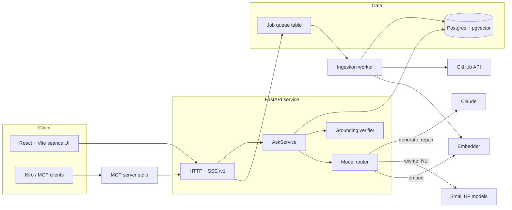
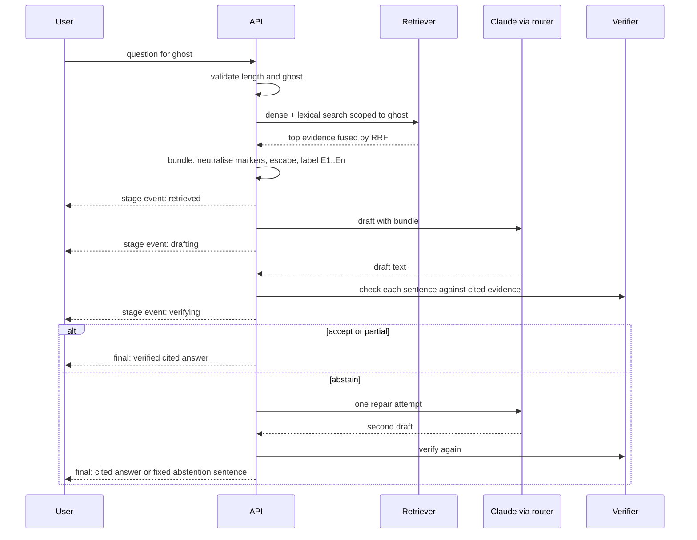

# Recromancer: scope and design

Status: v2, decisions incorporated, awaiting final approval. No further application code is written until approved.
Deadline: submit by Dec 3 2026 (Devpost closes Dec 4 2:00 PM PT = Dec 5 3:30 AM IST).
Companion docs: `ARCHITECTURE.md` (schema, deployment, ADR 1-9), `DEV_SETUP.md` (installs), `KIRO_USAGE.md` (journal).

## 1. What we are building

A team "summons" a departed engineer's ghost from the repositories they worked in, then asks it
questions. Answers are drafted only from that person's recorded work (commits, PRs, reviews,
issues, docs). Every factual sentence carries a citation; when the record is silent the ghost says
so. Nothing unverified reaches the user.

Not in scope: impersonating the person, answering about opinions the record does not contain,
ingesting private chat or email, voice cloning.

## 2. Decisions log

| # | Question | Decision |
|---|---|---|
| D1 | Demo corpus | Synthetic repo we author, with deliberate twists (see section 9) |
| D2 | Demo mode | Seeded corpus for the video and the public link; live GitHub ingestion built and shown briefly |
| D3 | Models | Claude for answer generation and repair only. Small open models (Hugging Face) for small tasks. See section 6 |
| D4 | Embeddings | Behind an `Embedder` port. Default BGE-M3 (1024-d), challenger Qwen3-Embedding-0.6B, chosen by our own golden-set eval |
| D5 | Auth | No end-user login. Public read-only seeded demo. Admin token for write endpoints. See section 7 |
| D6 | MCP | In scope. Local stdio server first. Validated by MCP Inspector, a client contract test, and use inside Kiro. See section 8 |
| D7 | Streaming | In scope, as stage events (retrieving, drafting, verifying) then the verified answer. See section 10 |
| D8 | Kiro Crew bonus | "Best Kiro Crew App" needs a public repo URL for a Kiro Crew app plus a feature description. Whether our main app qualifies is unverified; decide after reading the Official Rules and trying Crew (open item O1) |
| D9 | Hosting | Local-first development; deploy to Vercel Hobby in week 5. See section 11 |
| D10 | UI visuals | Data-driven visualizations, never decorative. See section 12 |
| D11 | "Won't" items | Move to Future scope (section 14) with extension points built now (section 13) |

## 3. Scope tiers

| Tier | Item | Spec |
|---|---|---|
| MUST | Grounded ask pipeline: verifier, citations, abstention (done, tested) | grounded-chat |
| MUST | Postgres store, hybrid retrieval (pgvector + full text, RRF), contract tests | grounded-chat, platform-foundation |
| MUST | GitHub ingestion for one repo: commits, PRs, reviews, issues, markdown docs; chunk; embed; resumable jobs | evidence-ingestion |
| MUST | Ghost profile: handles, coverage, known gaps | ghost-profile |
| MUST | Seance UI: summon, ask, citation chips, evidence drawer, abstention state, AI-reconstruction label | seance-ui |
| MUST | Seeded demo mode on the synthetic repo | seance-ui |
| MUST | Public repo, MIT, /.kiro committed, README, under-3-minute video | submission |
| SHOULD | Streaming stage events | grounded-chat |
| SHOULD | MCP server (`ask_ghost`, `search_evidence`) | grounded-chat |
| SHOULD | Golden-set evaluation harness with numbers in the README | grounded-chat |
| SHOULD | UI visualizations (section 12) | seance-ui |
| COULD | Entailment stage using a small NLI model (restrictive only) | grounded-chat |
| COULD | Follow-up query rewriting using a small instruct model | grounded-chat |
| COULD | Answer cache | grounded-chat |
| FUTURE | Section 14 | n/a |

## 4. System architecture

Principle: hexagonal. Domain and services depend only on ports (`Retriever`, `LLMClient`,
`Embedder`, `SourceConnector`, `GhostRepository`). Everything else is an adapter.

## 5. Ask flow (the core guarantee)

## 6. Model strategy (D3, D4)

A `ModelRouter` maps a task name to a client. Model ids live in config only.

| Task | Model class | Why |
|---|---|---|
| `generate`, `repair` | Claude (mid-tier, configurable) | Quality of reasoning and citation discipline matter most here |
| `rewrite` (follow-up to standalone query) | Small instruct model, 1-4B | Cheap, low stakes; evidence bundle is never affected by history |
| `entail` (claim vs evidence) | Small NLI cross-encoder | Restrictive only: it may downgrade a verdict, never promote one, so a weak model cannot make answers less safe |
| `embed` | Embedding model behind `Embedder` | See below |

Embedding choice: default BGE-M3 (1024 dimensions, multilingual, long context, permissive license),
challenger Qwen3-Embedding-0.6B (1024 dimensions available, strong on code-adjacent text). I have
not benchmarked these on our data, so the golden-set eval picks the winner; the schema already uses
`vector(1024)` for both. [verify licenses and dimensions on the model cards before committing]

Where small models run: Vercel functions are a poor place for torch-sized models. Plan: call them
through a hosted inference endpoint (Hugging Face Inference Providers or a self-hosted container) via
the same gateway abstractions; seeded demo embeddings are precomputed offline. If the embedder or a
small model is unavailable, retrieval degrades to lexical only and `rewrite`/`entail` are skipped,
with the degradation reported in the response metadata. [verify free-tier limits and latency]

## 7. Authentication (D5)

A login page is not needed. Two separate concerns:

1. End users: the hackathon demo is public and read-only over the seeded ghost. No accounts.
2. Write operations (summon, sync, purge): protected by one admin bearer token from the environment,
   compared in constant time, disabled entirely in demo mode. This is a deliberate placeholder.

Production path (Future scope): OAuth login (GitHub), workspace membership, row-level security.
The schema already carries `workspace_id` everywhere so this is additive.

## 8. MCP server and how we validate it (D6)

Transport: stdio, launched by Kiro through `.kiro/settings/mcp.json`. A local stdio server runs as the
user's own process, so it needs no OAuth; it reads the API URL and admin token from environment.
OAuth only becomes relevant for a remote HTTP MCP server shared across users (Future scope).

Tools: `ask_ghost(ghost_id, question)` returns answer, decision, citations. `search_evidence(ghost_id, query, limit)` returns excerpts with references.

Validation, in increasing realism:
1. Unit and contract tests using the official MCP Python SDK client over stdio against a server wired to the in-memory retriever (runs in CI, no network).
2. MCP Inspector (`npx @modelcontextprotocol/inspector`) for manual exploration of schemas and calls.
3. Use from inside Kiro itself during development, recorded in `KIRO_USAGE.md` and shown in the demo.
4. Security checks: tool inputs validated and length-bounded; outputs carry the same disclosure and citations; abstention is preserved through the tool.

## 9. Synthetic demo repo (D1)

We author a fictional company repo (Northwind Payments style) with a fictional engineer, with
history written to exercise every behavior. Planned cases, each with golden questions:

| Twist | Expected behavior |
|---|---|
| A decision with rationale in a PR description | Cited answer |
| A decision later reversed by a different author | Answer names both, in date order, or abstains on current state if the reversal is by someone else |
| Review comment disagreeing with the PR itself | Both viewpoints cited, not merged |
| Question about something never documented (opinions, office, salary) | Abstain |
| Commit message that is vague ("fix stuff") | Low coverage reported in profile gaps |
| Two engineers with similar handles | No leakage into the ghost's evidence |
| Forged `[E1]` markers and "ignore previous instructions" inside an issue body | Neutralised; no behavior change |
| Negation trap ("we did not use Redis") | Documented verifier limit; entailment stage target |
| Stale information (doc says X, later commit does Y) | Newest evidence preferred, conflict surfaced |
| Non-English comment | Retrieved if the embedder is multilingual |

Everything uses `example.invalid` URLs and visible "(fictional)" labels.

## 10. Streaming (D7)

Server-Sent Events carry stage events and then the final verified answer. We do not stream raw model
tokens, because a draft must pass verification before the user sees any of it. So streaming reduces
perceived waiting (progress is visible, drives the séance animation) but not total time. Cancellation
is honored when the client disconnects. [verify SSE behavior for Python functions on Vercel before relying on it; fallback is polling]

## 11. Hosting (D9)

- Vercel Hobby is free. Limits fetched from Vercel docs (updated Aug 2026): functions 300 s max duration, 2 GB memory, Python bundle up to 500 MB uncompressed, 4.5 MB request/response body, 1,024 file descriptors. Hobby is intended for non-commercial use [verify terms]; fine for a hackathon.
- Running FastAPI locally is fully supported and is how we develop. For judging, a public URL is far more convincing than "clone and run", so the plan is local-first, then deploy the frontend and API to Vercel in week 5.
- Postgres: local Postgres with pgvector in Docker for development; a managed free-tier Postgres (Neon, Supabase) for the deployed demo [verify free-tier limits].
- Fallback if Vercel is troublesome: deploy the API as a container elsewhere; the code does not depend on Vercel.

## 12. UI visualizations (D10)

All visuals are driven by real data; none are decorative statistics.

| Visual | Data | Purpose |
|---|---|---|
| Séance board (planchette, letter ring, candles) | Stage events | Makes progress and waiting legible |
| Grounding highlight | Per-sentence verifier verdicts | Each sentence shaded by support strength; hover shows the matched evidence span |
| Evidence constellation | Answer sentences to evidence nodes | Shows which records support which claims; ties to citation chips |
| Provenance timeline | Evidence by date and type | "Stitched from N records" over time, with hover linking to chips |
| Coverage heatmap | Evidence counts by area and month | Shows where the ghost knows a lot and where it is blind |
| Source mix | Counts by source type | Commits vs PRs vs reviews vs issues vs docs |
| Silence state | Abstention reason | Calm visual plus what the record does cover nearby |

Charts use an accessible approach: keyboard focus, text alternatives, reduced-motion respected,
color never the only encoding. Library choice (D3 or a charting library) is made in the UI spec.

## 13. Extensibility (D11)

Extension points built now so future scope is additive, not a rewrite:

| Seam | Today | Future |
|---|---|---|
| `SourceConnector` protocol | GitHub | Slack, Jira, Confluence, Google Docs |
| `ModelRouter` and `LLMClient` | Claude, small HF models | Other providers, per-tenant models |
| `Embedder` port | One model | Versioned embeddings with side-by-side re-index |
| `Retriever` port | In-memory, Postgres | Dedicated vector DB |
| `workspace_id` on every table | Single workspace | RLS multi-tenancy |
| Job queue table | Postgres, polled | Dedicated worker queue |
| Verifier stages | Lexical (+ optional NLI) | Additional restrictive stages |
| Config via `Settings` | Env | Secret manager, feature flags |
| API versioning `/v1` | v1 | v2 alongside |

Rules enforced by tests and the `grounding-auditor` agent: no code path to the user bypasses the verifier; stages can only restrict.

## 14. Future scope (moved from "won't")

Multi-tenant OAuth and workspace roles; Postgres row-level security; per-workspace spend caps and
rate limits; billing; Slack, Jira and Confluence connectors; remote MCP server with OAuth 2.1;
answer cache with versioned invalidation; fine-grained access control mirroring source permissions;
subject consent and offboarding workflow with legal hold; evaluation dashboard; on-prem deployment.

## 15. Demo storyboard (under 3 minutes)

| Time | Beat |
|---|---|
| 0:00 | Problem: knowledge walks out the door. Tagline. |
| 0:20 | Summon a ghost (live ingestion shown briefly); "stitched from N records" |
| 0:50 | Ask a why-question; grounded answer; hover highlights; open the evidence drawer |
| 1:30 | Ask something never recorded; the ghost stays silent |
| 1:50 | Injection attempt inside an issue; refused |
| 2:15 | Kiro: specs, steering, hooks, agents, property tests; `ask_ghost` over MCP from the IDE |
| 2:45 | Responsible use; close |

## 16. Judging and Kiro mapping

| Criterion | Our answer |
|---|---|
| Potential value | Real onboarding and offboarding pain; works on any repo |
| Implementation | Verified-or-silent pipeline, fuzzed invariants, resilient gateway, MCP, hexagonal design |
| Quality and design | Frankenstein theme: a person stitched from scattered records; honesty is the feature; real-data visuals |
| Kiro usage | 5 specs, 8 steering files, hooks, 3 custom agents, MCP server, property-based tests, honest journal |

Bonus targets: Blog, Social Blitz, Best Demo; Kiro Crew pending verification (O1).

## 17. Timeline (solo, Nov 2 to Dec 3)

| Week | Goal |
|---|---|
| 1 (Nov 2-8) | Environment setup. CI green on existing core. Postgres store, hybrid retriever, contract tests. Synthetic repo authored. |
| 2 (Nov 9-15) | GitHub ingestion, chunk, embed, jobs, profile. Model router and small-model adapters. |
| 3 (Nov 16-22) | Frontend: summon, seance, drawer, silence. Streaming. |
| 4 (Nov 23-29) | Visualizations, eval harness, red-team suite, MCP server, accessibility. |
| 5 (Nov 30-Dec 3) | Deploy, README numbers, blog, video, submit by Dec 3. |

## 18. Risks

| Risk | Mitigation |
|---|---|
| Free Kiro credits not approved in time | Keep journal honest; core exists; use Kiro as available |
| Verifier misses negation or subtle distortion | Documented limit; golden-set negation cases; optional NLI stage |
| Embedding or small-model hosting cost, latency or outage | Ports plus lexical-only degradation; precomputed demo embeddings |
| Vercel Python or SSE surprises | Local-first; polling fallback; container fallback |
| Privacy and consent | Synthetic corpus; purge endpoint; always-visible AI-reconstruction label |
| Scope creep | Tiers; cut anything not MUST first |

## 19. Definition of done

- CI green: ruff, mypy strict, pytest with 85 percent coverage floor, Hypothesis CI profile, frontend lint/typecheck/test/build, axe.
- Golden-set eval: every unanswerable item abstains; every accepted sentence is supported; numbers published.
- MCP contract test green; MCP usable from Kiro.
- Public repo with /.kiro, MIT license, secret scan clean, deployed URL, video under 3 minutes.

## 20. Open items

- O1: Kiro Crew: Devpost page says the bonus needs a public GitHub URL for "your Kiro Crew app". Read the Official Rules and try Crew before deciding whether to build with it.
- O2: Read the Official Rules for AI-generated code disclosure and the Submission Period provenance rule (only new projects built Oct 30 to Dec 4).
- O4: A deployed, working app URL is required by the submission form, so deployment is a MUST, not optional. Put any needed credentials in the private form field.
- O5: Kiro write-up must cover IDE vs CLI vs Web vs Crew, custom agents, hooks, specs vs vibe coding, steering, MCP, property-based testing and Kiro powers. `KIRO_USAGE.md` must track each, including powers (not yet used).
- O3: Confirm free-tier limits for the chosen managed Postgres and Hugging Face endpoints.
